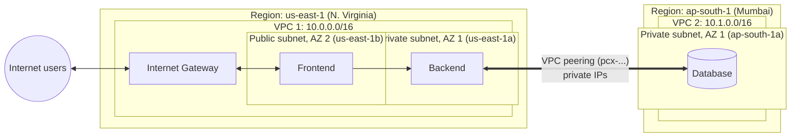

# Inter-Region AWS VPC Peering: Three-Tier App Across N. Virginia and Mumbai

A multi-region AWS network that connects two VPCs in different regions using **VPC peering**, so a backend in **N. Virginia (`us-east-1`)** can reach a database in **Mumbai (`ap-south-1`)** over **private IP addresses**, with no public exposure and no VPN.

- **VPC 1, N. Virginia:** a public subnet for the **frontend** and a private subnet for the **backend**.
- **VPC 2, Mumbai:** a private subnet for the **database**.
- **Peering connection** between the two VPCs, with explicit routes and security group rules on both sides.

---

## Table of Contents

1. [Purpose](#purpose)
2. [Architecture](#architecture)
3. [Network Plan](#network-plan)
4. [Traffic Flow and Isolation](#traffic-flow-and-isolation)
5. [Prerequisites](#prerequisites)
6. [Setup: Step by Step (AWS CLI)](#setup-step-by-step-aws-cli)
7. [Setup: Console Summary](#setup-console-summary)
8. [Validation](#validation)
9. [Troubleshooting](#troubleshooting)
10. [Cost Notes](#cost-notes)
11. [Teardown](#teardown)
12. [Design Decisions and Limitations](#design-decisions-and-limitations)
13. [Possible Improvements](#possible-improvements)
14. [Skills Demonstrated](#skills-demonstrated)
15. [Author](#author)

---

## Purpose

Real applications often have to place data in a different region from the application tier, for example for **data residency**, **disaster recovery**, or **proximity to a user base**. This project shows how to do that securely on AWS:

- Keep the database **private** (no public IP, no internet route).
- Let only the backend tier reach it, across regions.
- Keep the web tier as the only internet-facing component.

It covers VPC design, CIDR planning, inter-region peering, route tables and security groups.

## Architecture



| Tier | VPC / Region | Subnet | Reachable from |
|---|---|---|---|
| Frontend | VPC 1, N. Virginia | Public subnet, AZ 2 | Internet (HTTP/HTTPS) |
| Backend | VPC 1, N. Virginia | Private subnet, AZ 1 | Frontend only |
| Database | VPC 2, Mumbai | Private subnet, AZ 1 | Backend subnet only, via peering |

## Network Plan

CIDR blocks of peered VPCs **must not overlap**. The values below are **examples**; replace them with the ranges you used.

| Item | Region | CIDR (example) |
|---|---|---|
| VPC 1 | us-east-1 | `10.0.0.0/16` |
| VPC 1 private subnet (backend) | us-east-1a | `10.0.1.0/24` |
| VPC 1 public subnet (frontend) | us-east-1b | `10.0.2.0/24` |
| VPC 2 | ap-south-1 | `10.1.0.0/16` |
| VPC 2 private subnet (database) | ap-south-1a | `10.1.1.0/24` |

## Traffic Flow and Isolation

| From | To | Allowed? | Why |
|---|---|---|---|
| Internet | Frontend | Yes | Public subnet, IGW route, security group opens 80/443 |
| Frontend | Backend | Yes | Same VPC (`local` route); backend security group allows the app port from the frontend security group |
| Backend | Database | Yes | Route to Mumbai via peering, database security group allows the DB port from the backend subnet CIDR |
| Frontend | Database | **No** | The public subnet's route table has no peering route, and the database security group does not allow it |
| Internet | Backend or Database | **No** | No public IPs and no inbound internet route |
| Database | Internet | **No** | VPC 2 has no Internet Gateway or NAT Gateway |

Only the backend subnet is given a route to VPC 2. This is **least-privilege routing**: peering gives network reachability, so routes and security groups decide exactly who may use it.

## Prerequisites

- AWS account with permissions for EC2/VPC in both `us-east-1` and `ap-south-1`.
- AWS CLI v2 configured (`aws configure`).
- VPC 1 already created with its public and private subnets, Internet Gateway, and route tables (see the companion VPC project). The commands below assume you have these IDs:

```bash
export VPC1_ID=vpc-xxxxxxxx            # N. Virginia VPC
export RT_PRIV1=rtb-xxxxxxxx           # route table of VPC 1 private (backend) subnet
export BACKEND_SUBNET_CIDR=10.0.1.0/24
```

## Setup: Step by Step (AWS CLI)

### 1. Create VPC 2 in Mumbai

```bash
# VPC and private subnet for the database
VPC2_ID=$(aws ec2 create-vpc --region ap-south-1 --cidr-block 10.1.0.0/16 \
  --tag-specifications 'ResourceType=vpc,Tags=[{Key=Name,Value=vpc-mumbai}]' \
  --query Vpc.VpcId --output text)

DB_SUBNET=$(aws ec2 create-subnet --region ap-south-1 --vpc-id "$VPC2_ID" \
  --cidr-block 10.1.1.0/24 --availability-zone ap-south-1a \
  --tag-specifications 'ResourceType=subnet,Tags=[{Key=Name,Value=db-private-subnet}]' \
  --query Subnet.SubnetId --output text)

# Dedicated route table for the DB subnet (local route only for now)
RT_DB=$(aws ec2 create-route-table --region ap-south-1 --vpc-id "$VPC2_ID" \
  --tag-specifications 'ResourceType=route-table,Tags=[{Key=Name,Value=db-private-rt}]' \
  --query RouteTable.RouteTableId --output text)
aws ec2 associate-route-table --region ap-south-1 --route-table-id "$RT_DB" --subnet-id "$DB_SUBNET"
```

### 2. Request the peering connection (from N. Virginia)

```bash
PCX_ID=$(aws ec2 create-vpc-peering-connection --region us-east-1 \
  --vpc-id "$VPC1_ID" --peer-vpc-id "$VPC2_ID" --peer-region ap-south-1 \
  --tag-specifications 'ResourceType=vpc-peering-connection,Tags=[{Key=Name,Value=nvirginia-to-mumbai}]' \
  --query VpcPeeringConnection.VpcPeeringConnectionId --output text)
echo "$PCX_ID"     # state: pending-acceptance
```

For a VPC in a **different AWS account**, add `--peer-owner-id <account-id>`.

### 3. Accept the request (in Mumbai)

```bash
aws ec2 accept-vpc-peering-connection --region ap-south-1 --vpc-peering-connection-id "$PCX_ID"
# The request may take a few seconds to appear in the accepter region
aws ec2 describe-vpc-peering-connections --region ap-south-1 \
  --vpc-peering-connection-ids "$PCX_ID" --query 'VpcPeeringConnections[0].Status.Code'
# expected: active
```

### 4. Add routes on both sides

Peering does nothing until both route tables point at it.

```bash
# VPC 1 private (backend) subnet -> Mumbai VPC
aws ec2 create-route --region us-east-1 --route-table-id "$RT_PRIV1" \
  --destination-cidr-block 10.1.0.0/16 --vpc-peering-connection-id "$PCX_ID"

# VPC 2 DB subnet -> backend subnet in N. Virginia (return path)
aws ec2 create-route --region ap-south-1 --route-table-id "$RT_DB" \
  --destination-cidr-block "$BACKEND_SUBNET_CIDR" --vpc-peering-connection-id "$PCX_ID"
```

Do **not** add this route to the public subnet's route table, so the frontend cannot reach the database.

### 5. Security groups

Security groups cannot reference a security group in another region, so the database rule uses the backend subnet's **CIDR**.

```bash
export DB_PORT=3306    # example: MySQL. Use 5432 for PostgreSQL, 1433 for SQL Server, etc.

# Database security group in Mumbai
DB_SG=$(aws ec2 create-security-group --region ap-south-1 --vpc-id "$VPC2_ID" \
  --group-name db-sg --description "Allow DB access from backend subnet only" \
  --query GroupId --output text)
aws ec2 authorize-security-group-ingress --region ap-south-1 --group-id "$DB_SG" \
  --protocol tcp --port "$DB_PORT" --cidr "$BACKEND_SUBNET_CIDR"
```

In VPC 1, keep the usual rules:

- **Frontend SG:** inbound 80/443 from `0.0.0.0/0`.
- **Backend SG:** inbound application port from the **frontend security group** (same region, so a security group reference works), outbound to the database CIDR and port.

### 6. Launch the instances

Launch the frontend in the public subnet, the backend in the VPC 1 private subnet and the database in `db-private-subnet` with `db-sg` attached (or create an RDS instance in a DB subnet group there). Do not assign a public IP to the backend or database.

## Setup: Console Summary

1. **VPC console, Mumbai (`ap-south-1`):** create `vpc-mumbai` (`10.1.0.0/16`), a private subnet in AZ 1, and a route table associated with it.
2. **VPC console, N. Virginia:** *Peering connections, Create peering connection.* Choose VPC 1 as requester, *My account*, *Another Region, Asia Pacific (Mumbai)*, and the VPC 2 ID.
3. **Mumbai:** *Peering connections, select the request, Actions, Accept request.*
4. **Both regions:** edit the route tables as in step 4 (destination CIDR of the other side, target = the peering connection).
5. **Mumbai:** create the database security group allowing the DB port from the backend subnet CIDR.

## Validation

1. **Peering status.** The connection shows `active` in both regions.
2. **Routes.** `aws ec2 describe-route-tables` shows the peering route in `RT_PRIV1` and `RT_DB` only.
3. **Backend to database (should succeed).** From the backend instance:
   ```bash
   nc -zv <db-private-ip> 3306        # or: mysql -h <db-private-ip> -u <user> -p
   ```
   Reaching the backend itself requires a bastion/jump host or AWS Systems Manager Session Manager, since it has no public IP.
4. **Frontend to database (should fail).** From the frontend, the same `nc` command should time out.
5. **No public exposure.** The database and backend have no public IP, and the database cannot be reached from the internet.
6. **Latency check.** `ping` or a timed query from backend to database shows the cross-region round trip. (ICMP needs an explicit security group rule.)

## Troubleshooting

| Symptom | Likely cause |
|---|---|
| Peering stuck in `pending-acceptance` | The request was not accepted in the **peer region**. Switch the console/CLI region to `ap-south-1` and accept it |
| Peering `failed` or cannot be created | Overlapping CIDR blocks, or wrong peer region or VPC ID |
| Peering is `active` but connections time out | Missing route on **one side** (both directions are needed), or the database security group does not allow the backend CIDR |
| Connection refused (not timeout) | Network path is fine. The database is not listening on that port or its host firewall blocks it |
| Cannot reference a security group across regions | Not supported for inter-region peering. Use CIDR-based rules |
| Frontend can reach the database | A peering route was added to the public route table, or the database SG is too permissive |

## Cost Notes

- The peering connection has **no hourly charge**.
- **Inter-region data transfer is billed per GB.** Queries from the backend to the database, and the results returned, count toward this.
- Instances, RDS (if used) and any NAT Gateway are billed as usual in their own region.

## Teardown

1. Terminate instances (and delete any RDS instance).
2. Delete the peering routes from both route tables.
3. Delete the peering connection.
4. In Mumbai, delete the security group, subnet, route table and VPC.
5. Remove the VPC 1 resources if no longer needed (see the companion VPC project's teardown).

## Design Decisions and Limitations

- **Peering is not transitive.** VPC 2 cannot use VPC 1's Internet Gateway or NAT Gateway, and any third VPC peered to VPC 1 could not reach VPC 2 through it.
- **No overlapping CIDRs.** This must be planned up front, because changing a VPC's primary CIDR is not possible.
- **Cross-region latency.** N. Virginia and Mumbai are on opposite sides of the world, so each round trip is slow (often well above 100 ms). Chatty, many-small-queries access patterns will feel slow, so favor batched queries, caching, or moving the database closer.
- **Single database in a single AZ.** There is no high availability or backup replica in this design.
- **Database has no internet access.** Patching or package installs on a database host require a NAT Gateway or VPC endpoints in VPC 2.
- **Traffic stays on the AWS global backbone** rather than the public internet, but access control is still your responsibility (routes, security groups, NACLs, database authentication, TLS).

## Possible Improvements

- Enable TLS for database connections and store credentials in **AWS Secrets Manager**.
- Add a **cross-region read replica** or Multi-AZ configuration for resilience (if using RDS).
- Add a cache (for example ElastiCache) in VPC 1 to hide cross-region latency.
- Use **AWS Transit Gateway with inter-region peering** if more than a few VPCs need to be connected.
- Replace SSH access with **Session Manager** and add **VPC Flow Logs** for traffic auditing.
- Add a load balancer in front of the frontend and an Auto Scaling group for the backend.
- Provision everything with **Terraform or CloudFormation** for repeatability.

## Skills Demonstrated

- Multi-region AWS network design and non-overlapping CIDR planning
- Inter-region VPC peering: request, accept, route, verify
- Least-privilege routing and security group design for a three-tier architecture
- Private connectivity patterns (no public IPs for backend and database)
- Understanding of peering limits (non-transitive, no cross-region SG references) and cost implications
- AWS Console and AWS CLI usage

## Author

**Piyush Bhadange**
[GitHub](https://github.com/bhadangepiyush-droid) | [LinkedIn](https://www.linkedin.com/in/piyush-bhadange-a8a01328b)
